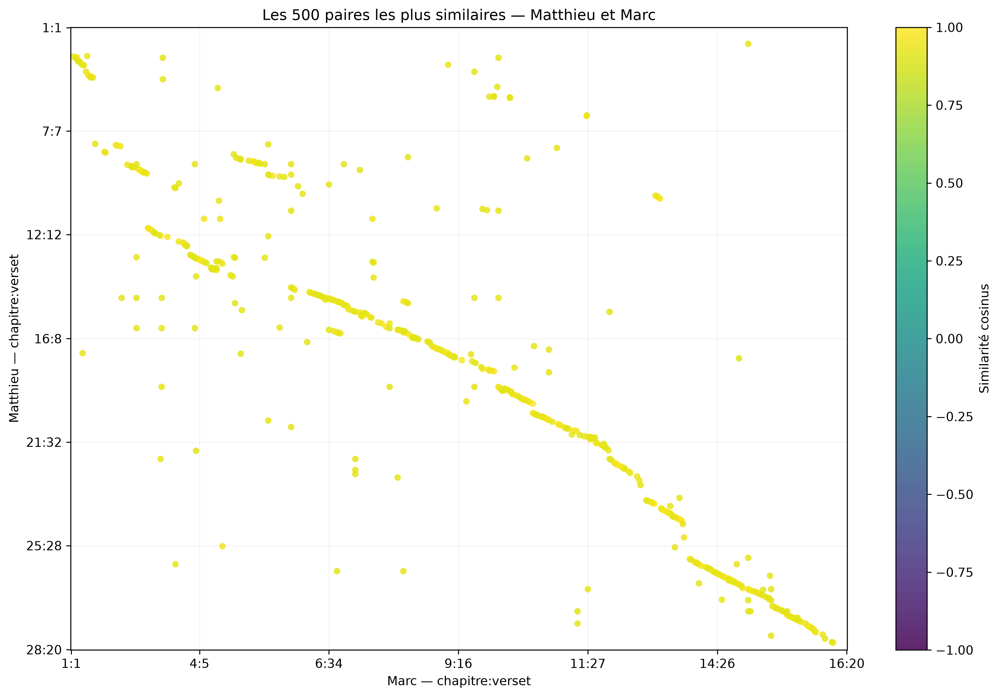
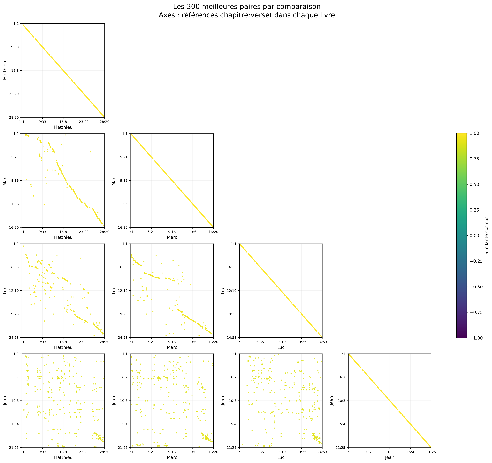

# Gospel Similarity Explorer

A personal experiment exploring connections between the four Gospels using **3,779 verses** from the French Louis Segond 1910 translation. Verses are embedded with `mistral-embed` through batch processing, then compared using cosine similarity. No model training required.



**Matthew × Mark:** the 500 most similar verse pairs. Diagonal segments suggest that related passages occur in a similar narrative order.



**All four Gospels:** the top 300 pairs per comparison. Alignments are especially clear between Matthew and Mark, while matches involving John are more scattered, with a cluster near the end. Each panel selects the same number of pairs, so it shows their distribution rather than the total number of similarities. Self-comparisons form the expected diagonal.

- **Python & notebooks:** generate embeddings and explore similarities with scatter plots, arcs, and parallel verse readings.
- **Interactive website:** choose books, chapters, and a verse, adjust the similarity threshold, and explore precomputed matches.
- **Observations:** illustrated commentary on patterns found in the results.

## Run the website locally

From the project root:

```sh
python3 -m http.server 8765 --directory web/dist
```

Open [localhost:8765](http://localhost:8765). The static website needs no API key. For Vercel, use `web/dist` as the root directory, select **Other**, and leave the build command empty.

## Project files

- `mistral_embeddings.py` and `embeddings.ipynb`: embedding workflow.
- `gospels-analysis.ipynb`: analysis and visualizations.
- `web/prepare_data.py`: export precomputed similarities for the website.
- `web/dist/`: deployable website, data, and images.

Similarity is a reading aid, not proof that two verses describe the same event.
